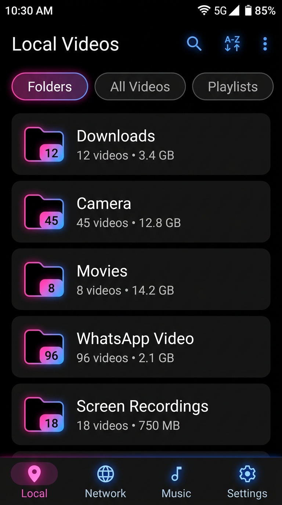
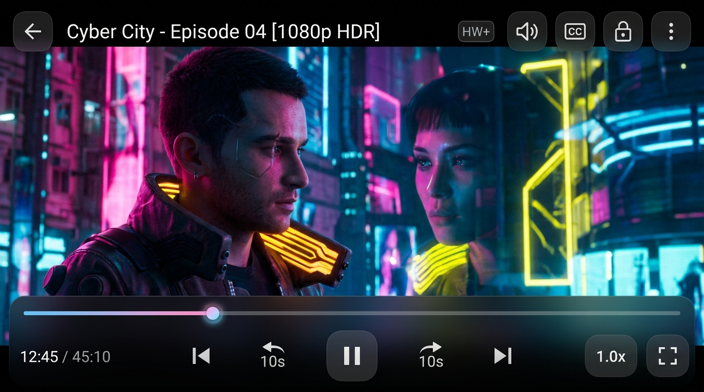
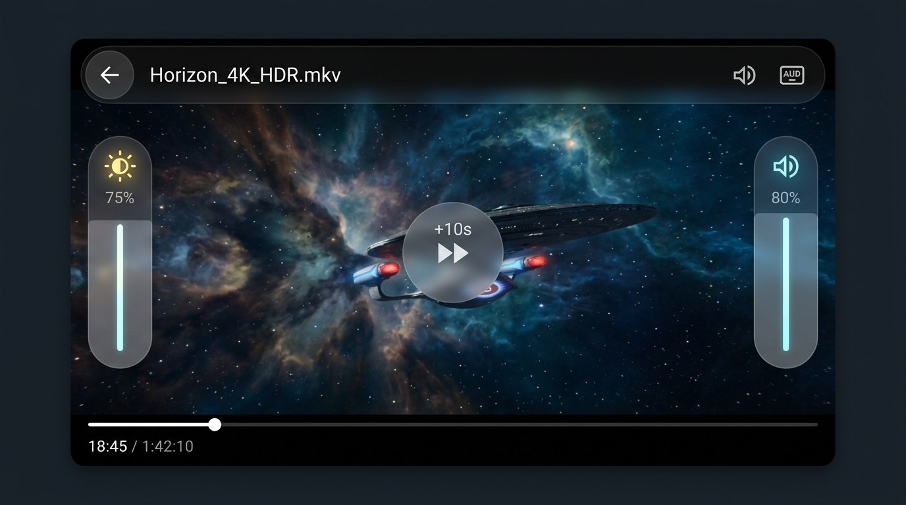
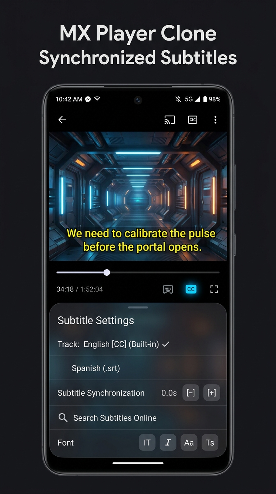
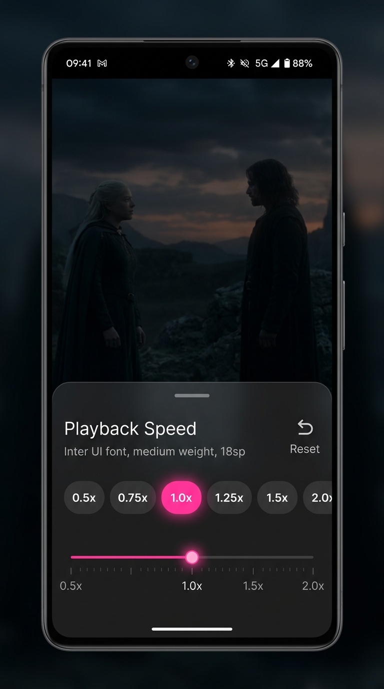
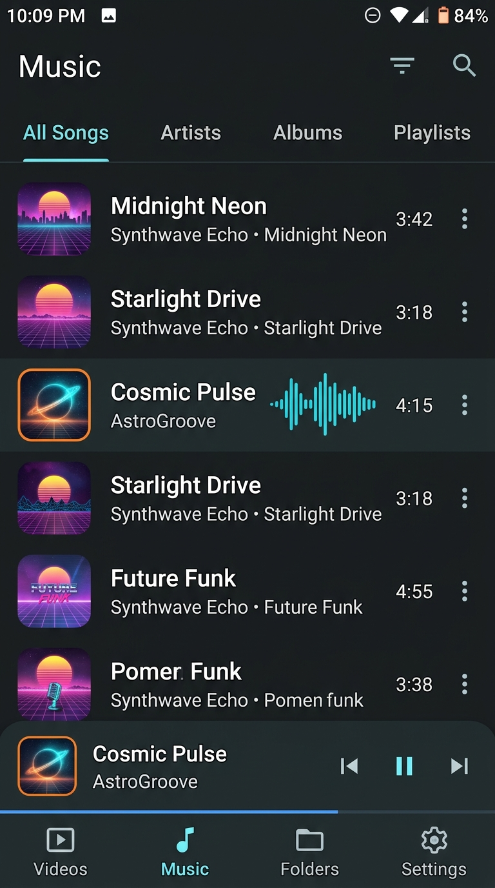
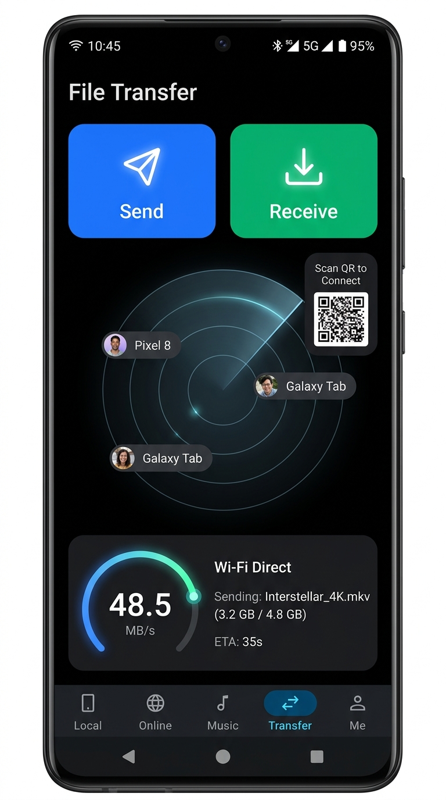
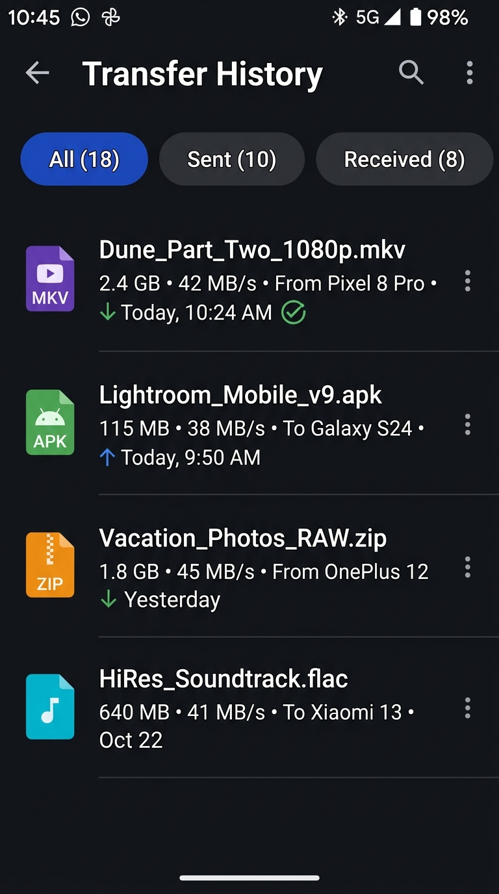
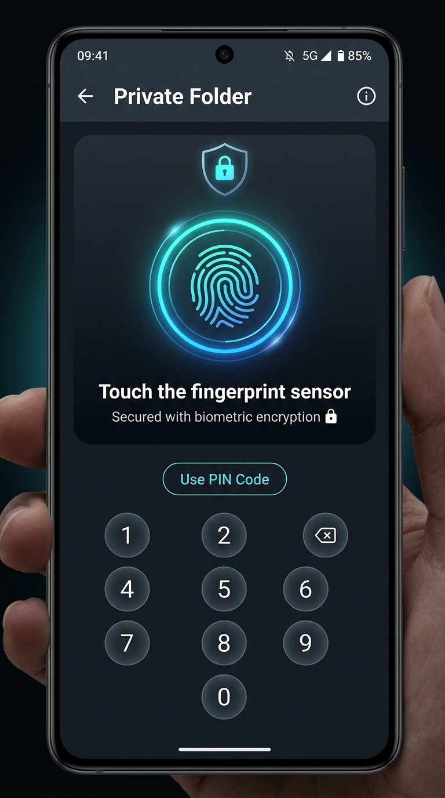
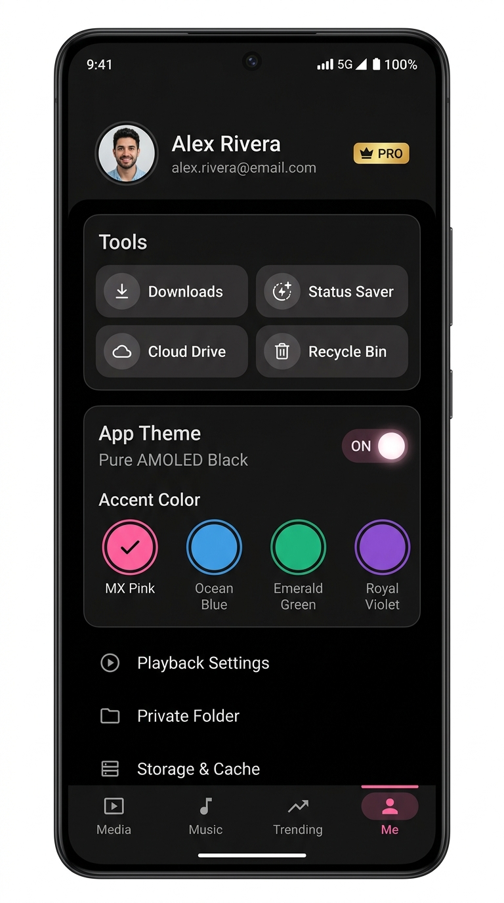

# 🎬 MX Player Clone (Flutter)

A modern, high-performance Flutter Android video player inspired by MX Player. Built with a sleek dark/AMOLED UI, hardware-accelerated rendering (`fvp`/libmpv), intuitive gesture controls, paired `.srt` subtitles, an offline music player, Wi-Fi LAN file transfer, and Room database-backed transfer history.

---

## 📱 App Screenshots (10 Main Screens)

| 1. Local Video Folders | 2. Fullscreen Video Player |
|:---:|:---:|
|  |  |
| *Auto-scans device storage with video counts & sizes* | *Hardware accelerated playback with full controls overlay* |

| 3. Swipe Gesture Controls | 4. Synchronized Subtitles |
|:---:|:---:|
|  |  |
| *Swipe left for brightness, right for volume, double-tap seek* | *Clean `.srt` subtitle rendering with custom style* |

| 5. Playback Speed Controls | 6. Offline Music Player |
|:---:|:---:|
|  |  |
| *Variable speed playback (0.5x to 2.0x)* | *Audio library, artist tags, and docked mini-player* |

| 7. Wi-Fi LAN File Transfer | 8. Transfer History & Storage |
|:---:|:---:|
|  |  |
| *Direct device-to-device sharing via radar & QR code* | *Room DB transfer logs with speeds, dates, and filters* |

| 9. Biometric Private Folder | 10. Me / Tools & AMOLED Themes |
|:---:|:---:|
|  |  |
| *Fingerprint & PIN security for private videos* | *Status saver, cloud drive, pure black AMOLED & accent colors* |

---

## ✨ Features

- **Hardware Accelerated Video Playback:** Powered by `fvp`/libmpv for seamless rendering across all Android chipsets.
- **Gesture Controls:**
  - Vertical swipe on left half: Screen brightness control.
  - Vertical swipe on right half: Media volume control.
  - Horizontal drag / Double-tap: Fast-forward (+10s) and rewind (-10s).
  - Pinch to zoom: Freely zoom and stretch video from 100% to 400%.
- **Subtitle Integration:** Automatic detection and loading of matching `.srt` subtitle files.
- **Audio & Music Player:** Built-in music screen with folder scanning, metadata display, and persistent bottom playback bar.
- **Wi-Fi LAN File Sharing:** Send and receive videos, music, and large files over local Wi-Fi / hotspot without internet data.
- **Room Database Transfer History:** Native Android Room DB tracking sent/received files, speeds, timestamps, and search filters.
- **Private Folder:** Biometric fingerprint and secure authentication to hide confidential media.
- **AMOLED Dark Theme:** Deep pitch-black AMOLED mode with customizable brand accent colors (MX Pink, Ocean Blue, Emerald, Violet).

---

## 🚀 GitHub Actions-ൽ നേരിട്ട് APK ബിൽഡ് ചെയ്യുന്ന വിധം (GitHub Actions Build)

ഈ പ്രോജക്റ്റിൽ **GitHub Actions Workflow** പൂർണ്ണമായി സജ്ജീകരിച്ചിട്ടുണ്ട് (`.github/workflows/build.yml`).

1. കോഡ് നിങ്ങളുടെ GitHub Repository-ലേക്ക് പുഷ് ചെയ്യുക.
2. നിങ്ങളുടെ GitHub Repository തുറന്ന് മുകളിലുള്ള **Actions** ടാബ് ക്ലിക്ക് ചെയ്യുക.
3. ഇടത് വശത്തുള്ള **Build Android APK** തിരഞ്ഞെടുക്കുക.
4. ബിൽഡ് വിജയകരമായി പൂർത്തിയാകുമ്പോൾ താഴെ **Artifacts** സെക്ഷനിൽ നിന്ന്:
   - **`MX-Player-Clone-Release-APK`** (ഏത് ഫോണിലും നേരിട്ട് ഇൻസ്റ്റാൾ ചെയ്യാൻ പറ്റുന്ന ഫുൾ റിലീസ് എപികെ)
   - **`MX-Player-Clone-Debug-APK`**
   ഡൗൺലോഡ് ചെയ്ത് ഫോണിൽ ഇൻസ്റ്റാൾ ചെയ്യാം!

---

## 🛠️ ലോക്കൽ സിസ്റ്റത്തിൽ റൺ ചെയ്യുന്ന വിധം (Local Development)

### Requirements
- Flutter SDK (`stable` channel)
- Java JDK 17
- Android SDK (API 34 / 35)

```bash
# ഡിപെൻഡൻസികൾ ഇൻസ്റ്റാൾ ചെയ്യാൻ
flutter pub get

# പ്രോജക്റ്റ് ടെസ്റ്റ് / റൺ ചെയ്യാൻ
flutter run

# റിലീസ് APK ബിൽഡ് ചെയ്യാൻ
flutter build apk --release --android-skip-build-dependency-validation
```

റിലീസ് APK ഈ പാത്തിൽ ലഭിക്കും: `build/app/outputs/flutter-apk/app-release.apk`
*(Debug Keystore ഉപയോഗിച്ച് സൈൻ ചെയ്തിരിക്കുന്നതിനാൽ അധികം സെറ്റപ്പുകൾ ഇല്ലാതെ ഏത് ആൻഡ്രോയിഡ് ഫോണിലും നേരിട്ട് ഇൻസ്റ്റാൾ ചെയ്യാം).*
